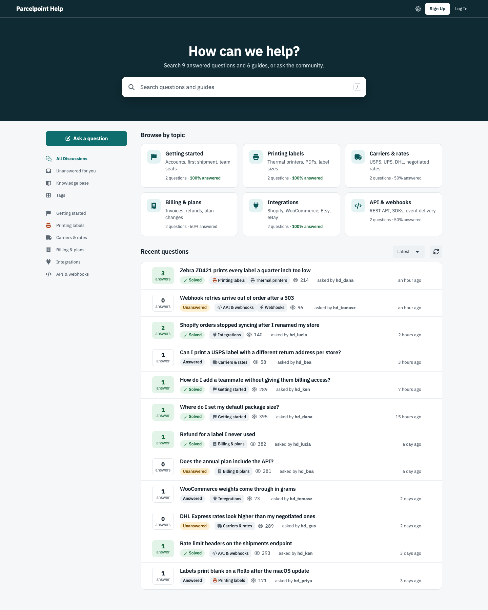
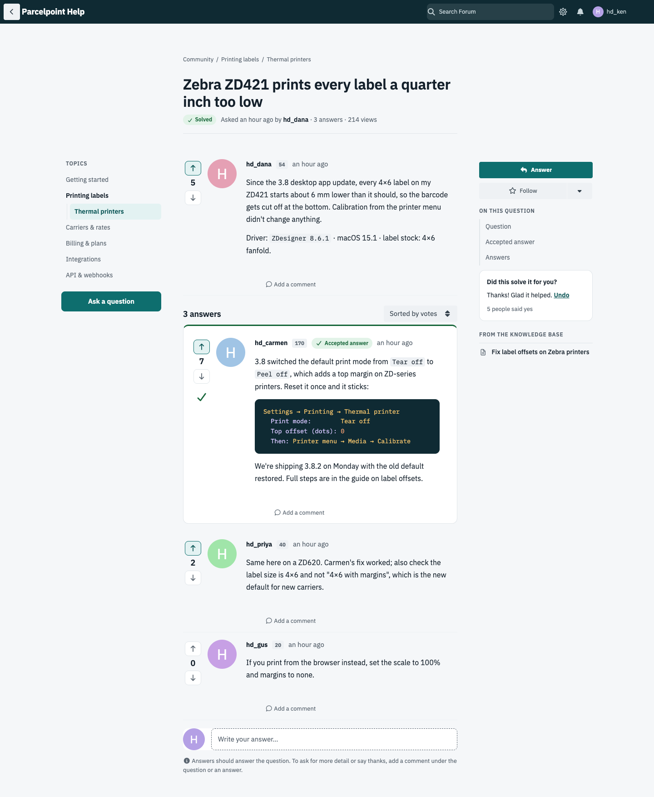
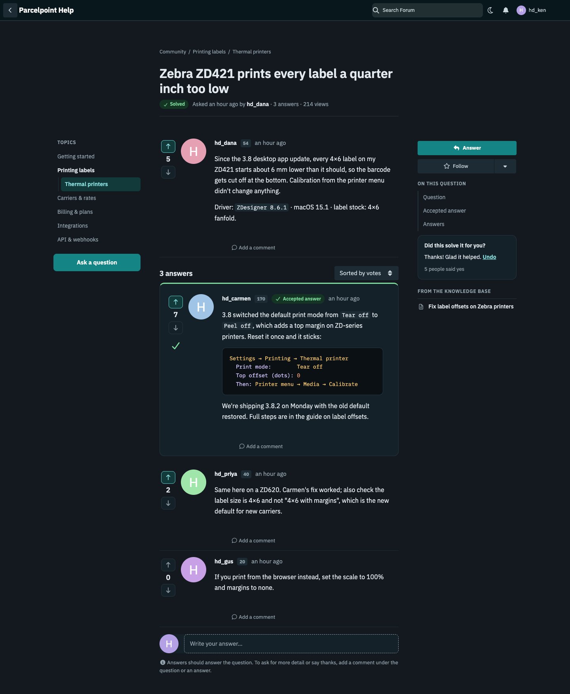
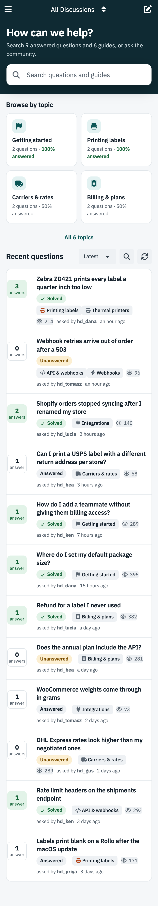
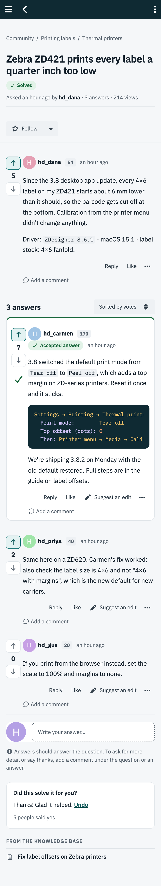

# Help Desk

**A search-first support theme for Flarum 2.** The home page opens on one big
search box, with a card for each topic that shows how much of it is answered.
Questions read like documentation: a topic tree on the left, the accepted
answer near the top, dark code blocks, an "On this question" contents list,
"Did this solve it?" and related knowledge base articles on the right.



---

## What it does

- **A search hero.** "How can we help?", how many answered questions and
  guides there are to search, and one big box. Press Enter (or <kbd>/</kbd>
  anywhere to jump to it) and Flarum's own search opens with your words in it,
  so whatever search the forum runs is the one people use: core's,
  [Typesense](https://github.com/ernestdefoe/typesense),
  [Manticore](https://github.com/ernestdefoe/manticore) or
  [OpenSearch](https://github.com/ernestdefoe/opensearch). Popular searches can
  sit underneath as chips.
- **Browse by topic.** A card for each top-level primary tag: its icon, its
  description, how many questions it holds and what share of them are
  answered.
- **A question list** with an answer-count box beside every question, green
  once an answer is accepted, and **Solved**, **Answered** and **Unanswered**
  pills.
- **Question pages that read like docs**: a breadcrumb, the state, who asked
  and when, answers and views under the title; a topic tree beside it; 16px
  text with roomy lines and dark, highlighted code blocks.
- **"On this question"**: jump to the question, the accepted answer or the
  rest of the answers.
- **"Did this solve it for you?"** under a solved question, with how many
  people said yes. One answer per member; they can change it or take it back.
- **From the knowledge base**: up to three related articles beside each
  question, when Knowledge Base (`ernestdefoe/knowledge-base`)
  is installed.
- **Dark mode**, following Flarum's own light, dark and high-contrast modes.
- **Phones** get a compact hero, two columns of topic cards and the solved box
  and guides after the answers.





 

---

## Answered, the way your forum already decides it

Help Desk doesn't decide what "answered" means. It shows what your Q&A
extension says:

| Installed | Questions | Answered | Pills and the accepted answer |
|---|---|---|---|
| [Answers](https://github.com/ernestdefoe/answers) | discussions in its Q&A tags | answered, solved or closed as a duplicate | Answers' own states and thread, in Help Desk's colours |
| [FoF Best Answer](https://github.com/FriendsOfFlarum/best-answer) | every discussion | a best answer is picked | Best Answer's own badge and post |
| neither | | | not drawn: the boxes count replies, the cards count discussions |

The topic numbers come from one grouped query for the whole forum, cached for
ten minutes. Each visitor gets the numbers only for the tags they can see.

---

## Settings

| Setting | Default |
|---|---|
| Accent color | teal `#0E6E6E` |
| Header color (the header and the search hero) | deep teal `#0F2A33` |
| Use IBM Plex Sans and Mono (served from your forum, never Google) | on |
| Search hero title | "How can we help?" |
| Search hero text | how many answered questions and guides there are |
| Popular searches (comma-separated chips) | none |
| Show topic cards on the home page | on |
| Topic cards to show | 6 |

The topic cards can also be placed anywhere with
[fof/forum-widgets-core](https://github.com/FriendsOfFlarum/forum-widgets-core).

---

## Install

```bash
composer require ernestdefoe/helpdesk
php flarum migrate
php flarum cache:clear
```

Then enable **Help Desk** in the admin panel. Works on its own, or beside other
themes with [Wardrobe](https://github.com/ernestdefoe/wardrobe), where members
pick their own theme.

## Update

```bash
composer update ernestdefoe/helpdesk
php flarum migrate
php flarum cache:clear
```

---

MIT licensed. IBM Plex Sans and IBM Plex Mono are © IBM Corp., under the SIL
Open Font License (`assets/fonts/OFL.txt`).
